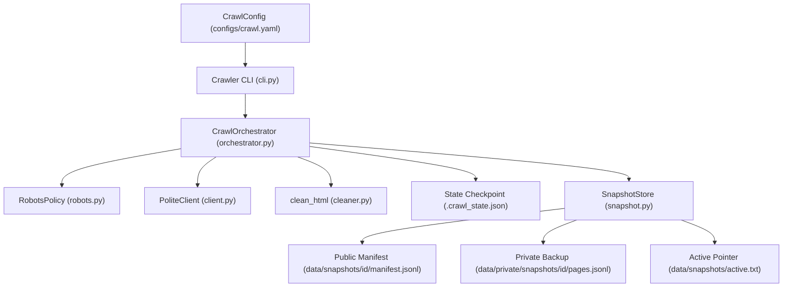
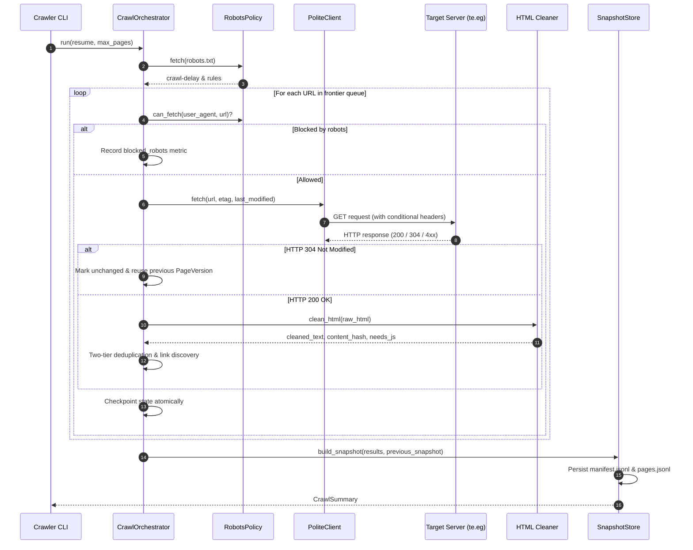
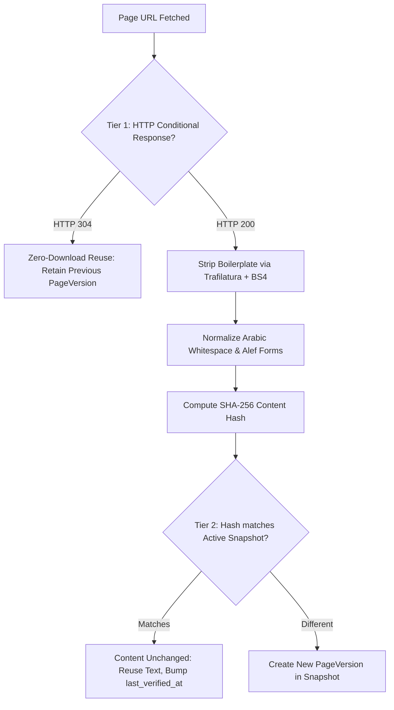

# ADR-0002: Polite web crawler and immutable versioned snapshots

## Status

Accepted on 2026-11-13.

## Context

Support Copilot requires a high-quality Arabic customer service knowledge base scraped from the official Telecom Egypt (WE) portal (`https://www.te.eg`). The portal runs on enterprise dynamic CMS software (Liferay Portal) containing dynamic JavaScript shells, CSRF tokens, volatile banners, and complex Arabic navigation.

Four engineering realities shape the crawler's design:

1. **Politeness and Compliance**: Automated crawlers must respect `robots.txt`, identify themselves with honest contact identifiers in the `User-Agent`, enforce inter-request polite delays, and include circuit breakers against consecutive server errors (HTTP 429 / 5xx) to never overwhelm upstream infrastructure.
2. **Dynamic CMS & Volatile Content**: Dynamic portals inject changing timestamp tokens, advertising carousels, and cookie headers into every response. If raw HTML is compared, every page appears changed on every crawl. We must isolate real textual content from UI chrome.
3. **Data Privacy and Copyright Boundary**: Web page text belongs to the website owner. Committing crawled page text to public Git repositories violates content ownership and bloats version control. We must commit only cryptographic hashes and metadata publicly, keeping raw HTML and cleaned text in private stores.
4. **Resilience to Interruption**: Crawling enterprise websites over network connections can be interrupted by timeouts, rate limits, or deployment restarts. The crawler must support atomic checkpointing and duplicate-free resumption.

## Decision

We implement a dedicated, modular, and polite crawler with immutable versioned snapshots, structured logging, OpenTelemetry tracing, and two-tier deduplication.

### 1. Component Architecture

### 2. Crawl Execution Lifecycle

### 3. Two-Tier Deduplication

To handle both static servers and dynamic CMS portals that omit `ETag` or `Last-Modified` headers, the crawler executes two-tier deduplication:

### 4. Storage Separation & Immutability

- **Public Manifest**: Written to `data/snapshots/<snapshot-id>/manifest.jsonl`. Contains only URL, canonical URL, language, HTTP status, content hash, cleaner version, and verification timestamp. Contains **NO page text** and is committed to Git.
- **Private Text Store**: Written to `data/private/snapshots/<snapshot-id>/pages.jsonl` (git-ignored). Stores full `raw_html` (for legal auditing and re-cleaning) and `cleaned_text` (for RAG chunking).
- **Snapshot Immutability**: Once saved, a snapshot folder is permanent and never overwritten or modified.
- **Active Pointer & Rollback**: An explicit pointer file (`data/snapshots/active.txt`) indicates the active production snapshot. Switching knowledge base versions or rolling back is an atomic O(1) pointer replacement.

## Consequences

### Positive

- **Deterministic RAG Grounding**: Every document chunk in the vector index traces back to an immutable snapshot ID, URL, content hash, and timestamp.
- **Bandwidth & Quota Efficiency**: Re-crawling unchanged websites reuses prior versions via conditional requests or content hashing with zero redundant chunking.
- **Privacy & Copyright Compliance**: Proprietary webpage content is never committed to source control repositories.
- **Production Observability**: Full OpenTelemetry tracing tree (`copilot.rag.crawl` root span with child spans per visited page) and Prometheus metrics exported to Jaeger and Langfuse.

### Trade-offs & Mitigations

- **Storage Volume**: Retaining `raw_html` in private backups requires disk storage (~30 MB per 100 pages). *Mitigation*: Public manifests remain small (<60 KB), and nightly jobs can compress or prune superseded private snapshots.
- **Client-Side Rendering (SPAs)**: Pure JavaScript shells return empty HTML templates. *Mitigation*: The cleaner detects JavaScript shells (`needs_js=True`) and flags them for headless browser processing in Step 2.0d.

## Alternatives Considered

- **Scrapy Framework**: Feature-rich but introduces an external reactive twisted runtime, complex middleware stacks, and difficult typing with modern async/await Python. Rejected in favor of native `httpx` + `asyncio`.
- **Headless Browser (Playwright) for all pages**: Executes JavaScript fully, but is 20x to 50x slower, CPU-heavy, and consumes excessive RAM on free hosting tiers (512 MB limits). Rejected for primary crawl; reserved only for pages marked `needs_js=True`.
- **In-Memory Crawler State**: Crawl state lost on process crash. Rejected in favor of atomic `.crawl_state.json` checkpointing.

## References

- PRD: FR-RAG-1, FR-KB-1 to FR-KB-5.
- Plan: Step 2.0a (Polite HTTP client), Step 2.0b (HTML cleaner & immutable snapshots), Step 2.0c (Crawl CLI & report).
- Architecture Decision: ADR-0001 (Ports and Adapters).
